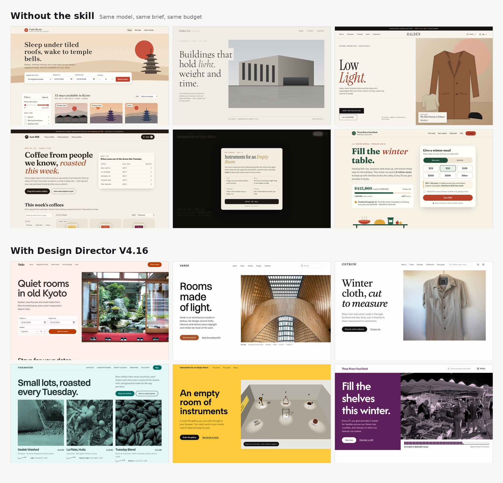
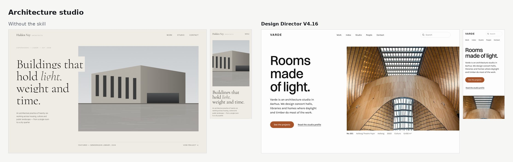
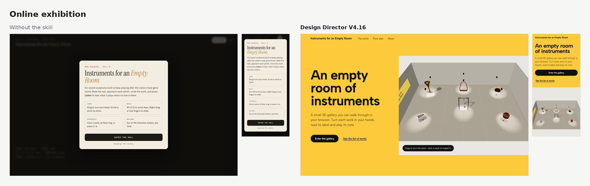
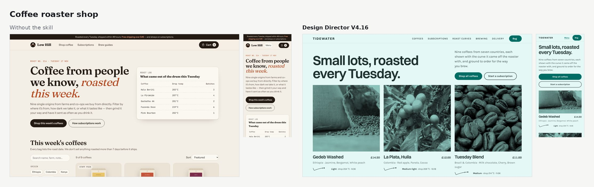
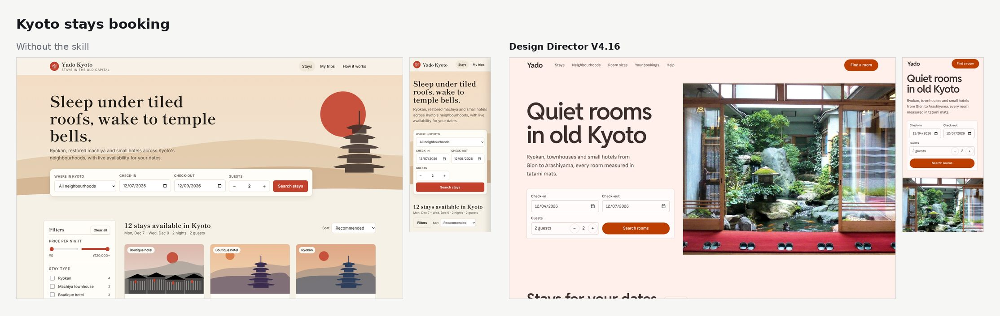
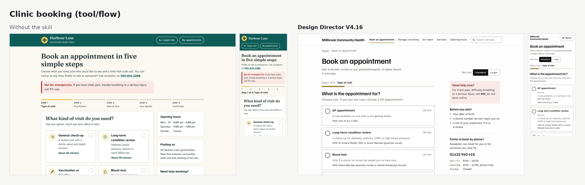

# Design Director

**A Claude skill for building web pages that look designed, not generated.**

Give Claude a brief for a landing page, a shop, a booking flow, a dashboard, a lesson or a story page. Design Director then works through a fixed method:

- decide what kind of page it is;
- borrow conventions from real sites of that kind;
- let scripts draw the ground, type, corners, navigation and colour tokens from real-site data;
- write the copy first, then build;
- check the result in a real browser before handing it back.

Current version: **V4.16.1** (V4.16's design rules plus workflow fixes: reference classification and fit, structure/surface split, style checks in check.py, `--url` for apps, a final report). See [CHANGELOG.md](CHANGELOG.md) for every version and the reason each rule exists.

[中文说明](#中文说明)



*Same model, same brief and the same budget (one check pass, one fix pass). Top: no skill. Bottom: Design Director V4.16. Real fonts, 1440×900 first screens.*

---

## Why

Ask a model for a web page with no brand spec and it tends to produce the same page every time. In our 50-task baseline:

- 28 pages used a cream background;
- Fraunces was the display face 20 times;
- 23 headlines used an italic-emphasis word;
- the hero was usually a small drawn illustration.

Each page looks polished on its own. Side by side they are one template with the content swapped.

Design Director replaces those defaults with decisions:

- **Mode first.** What does a visitor *do* here? *operate* (tools, dashboards), *read* (docs, lessons), *transact* (shops, bookings, forms), *persuade* (product and brand sites) or *experience* (stories, art, games). The mode decides the structure, how large type may go and how much colour is allowed.
- **Real sites, not taste.** `config/real_profiles.json` and `references/categories.md` hold profiles of real production sites in 49 categories: grounds, colour tone, corners, type and navigation. `scripts/assign.py` draws from them, so a bakery page and a dev-tool page start from different places.
- **Usable before memorable.** Tools, forms and bookings are built as the best real product of their kind, with no decorative concept borrowed from another world. Brand and story pages are built around the subject's most recognisable image, shown large.
- **A premium tier** (V4.16) for brand, story, experience and shop landing pages:
  - the hero head sits at 84–120px, in a 12-column, 1312px canvas;
  - a hero posture (Poster, Stage, Ledge, Corridor, Counter or Index) is drawn for each page;
  - the first screen holds only a head, one line, one or two actions and a big visual;
  - photographs come from a tagged library, with one treatment per page;
  - display faces are refined, and serif or italic is allowed when it fits.
- **Checked in a browser.** `scripts/check.py` screenshots the page at 1440, 375 and 320px with the real fonts. It reports overflow, covered or cut-off text, a missing first-screen task, missing focus rings and, on premium pages, heads or visuals that are too small.

## Results

The benchmark has 70 briefs (in `evals/`). Every page was built by the same model with the same budget (one check pass and one fix pass), with and without the skill. Screenshots use real fonts.

**Baseline vs V4.16 on 28 tasks:** 20 brand, shop and experience tasks, and 8 tool, form, flow and docs tasks.

| | Baseline (no skill) | V4.16 |
|---|---|---|
| Premium hero heads | serif + italic 16/20 (Fraunces 10) | sans 19/20 over 8 faces |
| Premium grounds | cream 11, dark 9, white 0 | white 9, colour field 7, dark 3, cream 1 |
| Hero pictures | mostly drawn illustrations | mostly real photographs, plus a 3D room and an interactive field |
| Sideways overflow | 2 pages | 0 |
| Tool pages | sound; 3 of 8 on cream with a serif head | same structures, all white, slightly more direct forms |

V4.16 reads more like real product sites, especially shops and bookings. The baseline still has more atmosphere on a few film, music and dream pages.

### Side by side

Each image shows the desktop first screen with the phone first screen beside it.

**Architecture studio:** a drawn grey box becomes the building itself, photographed large.


**Online exhibition:** an instruction card over a black screen becomes the 3D gallery you can walk through, on the first screen.


**Coffee roaster shop:** cream, a serif italic head and a table become the beans themselves and the week's three coffees.


**Kyoto stays booking:** a drawn pagoda and sun become a real ryokan courtyard, with the date search kept beside it.


**Clinic booking (a tool/flow page):** both are sound. V4.16 keeps the same steps, drops the cream and the serif, and puts the choices in one plain list.


**Blind vote, V4.16 vs V4.17 (20 tasks):** V4.16 won 10, V4.17 won 5, and 5 were ties. V4.17 tried forced head styles, a "mood" posture and type-led heroes when no on-subject photo existed. That lost, so V4.16 remains the current version.

## Install

Copy this repository into your Claude skills folder:

```bash
git clone https://github.com/yunningtang/DesignDirector ~/.claude/skills/design-director
```

You can also zip the folder and upload it as a skill in Claude.

The scripts need:

```bash
pip install pillow playwright
playwright install chromium
```

You will also need `curl` and, for real Google Fonts in screenshots, Node/npm. `scripts/fontroute.py` installs `@fontsource` packages on demand into `~/.cache/dd-fontkit`; set `FONTKIT` to change that.

### Photo library (recommended)

The premium tier works best with real photographs. Build the offline library once:

```bash
python3 scripts/fetch_photos.py               # all 755 photos, ~40 MB (slow: Wikimedia rate limits)
python3 scripts/fetch_photos.py coffee bread  # photos matching your subjects first
```

The photos go into `data/photolib2/`, which is git-ignored. Each photo keeps its own Wikimedia licence (CC0, public domain, CC BY or CC BY-SA). `scripts/photos.py` ranks them for a subject and prints the credit line for the page footer.

### Reference screenshots (optional)

`scripts/refs.py` can show 3–5 real-site screenshots per page from a local library in `data/refimg/` (or `$DD_REFS`). That library is not included, because the screenshots are of other people's sites. Without it, the skill works from `references/categories.md` alone.

## Use

In Claude, ask for a page as usual, for example "Build a landing page for a small coffee roaster that ships every Tuesday". The skill triggers on page and redesign requests. Claude reads `SKILL.md` and runs the steps:

```bash
# 1. draw the direction, ground, faces, corners and nav, and print the NEXT steps
python3 scripts/assign.py --candidates candidates.json --mode persuade --category food --seed coffee-roaster

# 2. colour tokens with contrast checks
python3 scripts/palette.py --brand "#8A4B2A" --scene light --strategy restrained   # assign.py prints the scene and strategy

# 3. photos for the hero (premium pages)
python3 scripts/photos.py "coffee beans roasting" --tone dark --n 8

# 4. check pass
python3 scripts/check.py index.html --primary ".hero .btn-primary" --premium
```

Tool, form and booking pages skip the candidate step: run `assign.py` without `--candidates`, and add `--flow` for forms and bookings.

To rerun a benchmark task, use `python3 scripts/assign.py --task 61_coffee-roaster ...`. It reads `evals/briefs/61_coffee-roaster.txt`.

## Layout

```
SKILL.md                 entry point: steps, and who decides what
CHANGELOG.md             every version and why each rule exists
references/
  modes.md               five modes: structure, type and colour limits
  categories.md          49 categories of real sites: what to borrow and what not to
  scenes.md, locale.md   behaviour, states and market conventions
  direction.md           subject inventory, candidates, contract
  craft.md               build rules (each tagged rule:<id>)
  review.md              check-pass questions
  defaults.md            known "AI default" looks to avoid
  examples.md            method examples
config/                  real-site profiles, fonts, nav profiles, structure, used-direction pool
scripts/
  assign.py              draws mode, ground, faces, corners and nav; prints the NEXT steps
  palette.py             colour tokens, contrast, default-palette warnings
  check.py               browser checks (--primary, --core, --premium, --url, --real-data, --no-style)
  photos.py              ranks the offline photo library
  fetch_photos.py        builds the offline photo library
  fontroute.py           real Google Fonts in Playwright screenshots
  refs.py, shoot_ref.py  optional real-site reference screenshots
evals/                   70 benchmark tasks (tasks.json, briefs/, criteria.md)
data/                    Hallmark photo list (metadata only) and its MIT licence
```

## Credits

- The premium tier is adapted from **Hallmark** (MIT; see [`data/HALLMARK_LICENSE`](data/HALLMARK_LICENSE)): the layout scale and hero postures, the imagery rules and photo list, the font classes, and the hero review questions.
- The photographs come from Wikimedia Commons, each under its own licence, with the author and source recorded in the library index.

---

## 中文说明

**Design Director** 是一个 Claude skill，用来在没有品牌规范的情况下做网页，让做出来的页面像是设计过的，而不是像模板生成的。

不用 skill 时，模型做的网页几乎都是同一套：米色底、Fraunces 斜体标题、一张画出来的小插画。用了 Design Director 之后：

- 先判断页面类型（工具、阅读、交易、宣传、体验），再从 49 类真实网站的数据里定底色、字体、圆角和导航；
- 工具和表单页按真实产品的标准做，不加装饰；
- 品牌和故事页用真实大照片、大字号标题、留白充足的首屏（V4.16 的高级感模式，改编自 Hallmark）；
- 先写文案再做页面，最后用真实浏览器和真实字体截图检查：溢出、文字被挡、首屏任务、焦点框、手机 320px。

在 28 道题上和不用 skill 的基线对比（见上方截图）：V4.16 更像真实的产品网站，商店和预约类尤其明显，也没有横向溢出。基线在少数电影、音乐类页面上更有氛围。盲选中 V4.16 以 10:5（5 题平局）胜过 V4.17，所以 V4.16 是当前版本。

安装、照片库和用法见上面的英文部分。
